# Global Message Tree

## One Logical Tree, Many Partial Replicas

All live transferable messages (sync blobs) form one logical Merkle tree. Each
node maintains its own partial, possibly stale view and continuously reconciles
it with other nodes. There is no authoritative global root, message ordering,
or consensus round. Equal roots mean equal indexed sets within the same scope
and tree version; delivery does not require network-wide equality.

The tree indexes encrypted publications by blob ID. Retries with different blob
IDs are separate leaves. Expired blobs leave the live tree. Historical
snapshots are retained for a bounded period.

## Structure and Storage

The index is a compressed 16-way nibble tree. Its key is the
hexadecimal sync-blob ID: a big-endian 32-bit stream number followed by the
SHA-256 hash of the transferable blob bytes. Stream prefixes therefore select
contiguous subtrees; prefixes beyond eight nibbles subdivide a single stream.

| Node | Contents |
| --- | --- |
| Leaf | Blob ID and absolute expiry (`TTL`). |
| Branch | Shared prefix, 16 child references, descendant leaf count, minimum and maximum expiry. |

Counts describe all descendant leaves. A leaf counts as one. The `TTL`,
`MinTTL`, and `MaxTTL` fields hold absolute expiry as `uint32` Unix seconds.
Tree shape MUST be deterministic for the same set, independent of arrival
order; empty trees and compressed branches need canonical representations.

A leaf hashes its blob ID; a branch hashes the concatenation of non-empty child
IDs in slot order, using SHA-256. Prefixes, empty slot positions, counts, and
expiry summaries are not directly hashed. A matching node hash MUST NOT be
treated as validation of these metadata.

Metadata MUST be checked against descendants: counts sum child leaf counts,
expiry bounds equal child minima and maxima, and descendant keys match the
branch prefix and child slots. At leaves, expiry MUST match the validated blob,
whose bytes are committed by its ID. Checking one level establishes only local
consistency; unchecked descendant summaries remain untrusted, and sampling
provides only probabilistic evidence about the full subtree.

The tree is independent of the storage engine and can be represented in a KV
store:

```text
node hash -> immutable index node
blob ID   -> transferable blob bytes
roots     -> current root and retained historical roots
```

When returning a root, the node MUST have access to all index nodes and blobs
in that snapshot. Garbage collection may remove them later.

## Snapshots and Garbage Collection

Reading a root selects a snapshot. All subsequent requests follow hashes from
that root. Insertions and removals change hashes along the affected path to the
root; unaffected subtrees keep their hashes.

```text
old root R0 -> old branch A0 -> existing leaves
           \-> branch B
new root R1 -> new branch A1 -> existing leaves + new leaf
           \-> branch B                 (shared)
```

A serving node retains recent roots and their reachable index nodes and blobs
for a bounded period so peers can continue traversing earlier snapshots.

The default retention period is ten minutes. Retention is best-effort. If a
requested snapshot node has been collected, return `not found`; the receiver
reads the latest root and restarts. Snapshot loss is handled as an availability
event.

The protocol assumes accurate clocks, with no clock-skew allowance. An expired
blob MUST NOT be imported, even when it belongs to a retained snapshot.

## Synchronization and Sharding



1. Read the peer's root and maintained stream prefixes together. Prefixes use
   zero to eight lowercase hexadecimal nibbles; `""` covers all streams and an
   empty list offers no maintained range. The root includes every retained live
   blob, including outgoing blobs outside the maintained ranges.
2. Capture the local root and compare the union of local pull ranges and remote
   export ranges in a single bidirectional walk. Pull ranges apply to every
   source, including sources with disjoint advertised coverage.
3. Skip equal hashes and align compressed paths before comparing differing
   branches. Validate and import missing blobs within local ranges; export
   missing blobs within the peer's ranges. Fixed stores receive all local blobs.
4. Retain valid local blobs when the peer lacks them. Cache successful comparisons
   and repeat with fresh snapshots. A collected snapshot ends the walk; the next
   round starts from the latest root.

Compare captured local and remote subtrees in one bidirectional walk. Equal
hashes skip a subtree. Align compressed paths before comparing child slots.
Import remote-only leaves within local coverage and export local-only leaves
within the destination coverage; fixed stores receive all local ranges.

Keep one in-memory checkpoint per source and compared range: both snapshot
hashes (including absent subtrees), local pull coverage, and destination push
coverage. Record it only after the entire exchange succeeds. An unchanged pair
and unchanged coverages skip traversal. A changed local hash triggers comparison
even if the remote hash stays the same. Failed exchanges remain eligible for
retry, while already imported blobs remain stored.

Checkpoints describe the captured snapshots. Concurrent changes and changes
caused by the exchange appear in subsequent snapshots and require another
comparison. Drop entries for inactive ranges; checkpoints belong to the local
replica lifetime.

A receiving node checks each incoming push against its current maintained
coverage after blob validation and before import callbacks or storage. A stream
outside coverage is rejected as unavailable (HTTP 503 / RPC unavailable).
This rejection carries no rating penalty or ban and does not acknowledge
delivery. Coverage may change after the sender reads it. Fixed stores accept
exports across all streams.

Coverage guides exports and shard discovery. Pulls can retrieve any available
blob within local selected ranges. Source rating increases for each newly
inserted received blob. Duplicate blobs and exports earn no increase.

Each account independently selects a range containing its receiver stream.
Selection starts at `minSplit`. While the observed leaf count exceeds the
target (default: 100,000) and depth is below `maxSplit`, descend one nibble
toward that stream. Stop at the target or fewer leaves, an empty range, or
`maxSplit`. Compressed paths follow
the same logical nibble depths. The defaults are `minSplit = 0` and
`maxSplit = 8`; the target applies separately to each account.

Selections live in node memory and apply across all sources. Accounts with the
same receiver stream share a selection. The node advertises and synchronizes
the normalized union of selected ranges; overlapping ranges share one traversal.
Removing an account preserves the selections of remaining accounts. A node
without accounts uses one random stream as its anchor for the process lifetime.
Restarting recalculates coverage from the local tree and subsequent observations.
Automatic synchronization evaluates the local tree before connecting sources.

Every ten minutes, each account reselects from `minSplit`, using a fresh local
snapshot and available density observations for its stream from the preceding
ten minutes. At each prefix, use the maximum observed leaf count across sources.
Replica counts are never summed. Keep the latest successful density observation
per source; a slower earlier check cannot replace a newer successful observation.
Observation age starts when snapshot checking begins. Failed reads and failed
validation do not refresh an observation. Account membership is checked again
before applying results of an asynchronous walk.

Between reassessments, higher observed density can narrow coverage immediately.
The background loop performs reassessment when due, including when no remote
sources are reachable. Local density is read from the validated index without
sampling. For a remote snapshot, first calculate candidate depths from branch
counts. Sample that snapshot only if a candidate would narrow an account's
current selection, and apply the narrowing only after verification succeeds.
Unchanged or wider candidates require no sampling.
Partial observations provide lower bounds on network population, so expansion
is provisional: subsequent observations can immediately narrow the range again.

Every selected range is synchronized in full, including ranges exceeding the
target at `maxSplit`. A depth of eight preserves the whole receiver stream.
Existing blobs outside the selected ranges remain available until expiry.
Counts measure leaves; byte size and arrival rate require separate resource
policies.

Hash-derived stream assignment is expected to spread recipients approximately
uniformly; traffic can still concentrate on a particular recipient. Nodes
participating in a shard synchronize that shard with one another. Progress
requires an available peer holding the missing blobs.

## Checking Untrusted Peers

A node SHOULD sample an advertised tree before using its claimed size to narrow
its scope, especially when that size greatly exceeds local observations. An
inflated count could otherwise force the client to reveal a narrow address
prefix. Sampling must use the captured root and receiver-chosen randomness.

Use the [source-check procedure](client-behavior.md#4-sync-source-check):
choose random leaf ranks weighted by descendant counts; at each visited branch
fetch all direct children, verify hashes and prefix placement, and check that
their counts sum to the parent count. At the selected leaf, fetch the actual
blob and verify its ID, canonical encoding, message hash, expiry, and PoW. The
hash-linked path back to the captured root is the Merkle inclusion proof. The
default is 20 independent samples.

Sampling gives probabilistic evidence about the advertised tree. A
self-consistent root alone proves neither valid PoW nor blob availability.
Invalid proofs, timeouts, expired blobs, and collected snapshots are distinct
outcomes of verification.

## Outgoing Delivery and Transport Capabilities

A locally published blob enters the local tree and a durable outgoing queue.
The queue also includes protocol-generated publications such as acknowledgments
and cover traffic. Publication expiry bounds delivery attempts.

- **Discoverable networks:** locate nodes advertising a prefix that contains
  the destination stream. Read their coverage, check whether they already have
  the blob, and push missing blobs. Record successful transfers by peer identity;
  different addresses of one peer count once. The default target is three peers,
  with retries after 30 seconds. These receipts indicate replica acceptance;
  recipient acknowledgment remains a separate mechanism.
- **Fixed stores:** import the selected ranges and export all locally held live
  blobs, including blobs outside local coverage. A removable database can carry
  publications between otherwise disconnected shards. Exporting to a fixed
  store leaves the P2P delivery queue eligible for further delivery.

Delivery requires a reachable replica of the destination range or a sequence of
fixed-store exchanges carrying the blob before expiry. Queue receipts do not
prove continued storage or independent ownership of accepting peers.

## Transport Contract

`GetSyncState` returns the root snapshot and maintained prefixes. A fixed store
can expose its root with full coverage. `FindShardPeers(stream)` belongs to
transports supporting range discovery. Blob validation and tree traversal use
the same source operations for both transport capabilities.

See [source operations and types](source-statistics-concept.md) for encoding.
